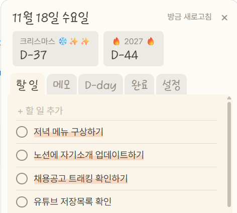
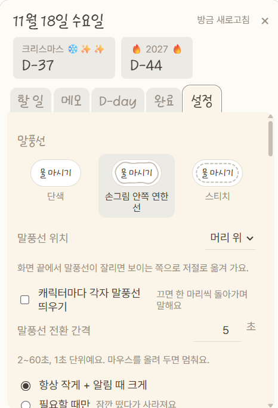
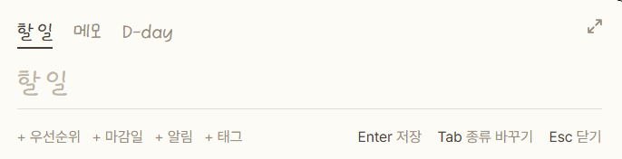

# Floaty

윈도우 바탕화면 위에 작은 캐릭터를 띄워두고, 오늘 할 일과 메모, D-day를 말풍선으로 보여주는 데스크톱 위젯이에요.
떠오르는 생각은 단축키로 바로 적어두고 하던 일을 계속하면 돼요.

  
  

**[최신 버전 내려받기](https://github.com/luvsummmer/floaty-releases/releases/latest)**

## 할 수 있는 것

- **말풍선으로 확인하기**: 작업표시줄 위의 캐릭터가 오늘 할 일, 메모, D-day를 몇 초마다 번갈아 보여줘요. 말풍선을 누르면 해당 목록이 열려요.
- **빠른 메모**: 단축키로 메모 창을 열고 할 일, 메모, D-day 중 하나를 골라 바로 저장해요. Tab으로 종류를 바꾸고 Enter로 저장해요.
- **전체 패널**: 할 일, 메모, D-day, 완료한 일을 탭으로 나눠서 보고 고칠 수 있어요. 상시 표시로 켜둔 D-day는 어느 탭에서든 맨 위에 보여요.
- **노션 연결 (선택)**: 노션에 로그인하면 템플릿이 복제되고, Floaty에서 쓴 내용이 노션과 양쪽으로 맞춰져요. 휴대폰 노션에서 고친 내용도 PC에 반영돼요. 연결하지 않아도 PC 안에서 다 쓸 수 있어요.
- **캐릭터 꾸미기**: 기본 캐릭터(오리, 개구리) 대신 원하는 PNG나 GIF를 넣을 수 있어요. 붙여넣기, 파일 선택, 끌어다 놓기 다 돼요. 최대 4마리까지 띄울 수 있고, 배경이 한 가지 색이면 자동으로 지워줘요.
- **보기 설정**: 캐릭터 크기, 말풍선 크기와 스타일, 말풍선 위치, 움직임 정도를 고를 수 있어요. 갖고 있는 TTF, OTF 폰트를 추가해서 말풍선 글꼴로 쓸 수도 있어요.
- **방해하지 않기**: 영상이나 게임, 발표처럼 전체 화면 앱을 쓰는 동안에는 캐릭터와 말풍선이 숨어요.

## 설치

1. [Releases](https://github.com/luvsummmer/floaty-releases/releases/latest)에서 `Floaty_x.x.x_x64-setup.exe`를 내려받아요.
2. 파일을 실행해요.
3. 아직 코드 서명이 없어서 처음 실행하면 "Windows의 PC 보호" 창이 떠요. **추가 정보**를 누른 뒤 **실행**을 눌러 주세요.

- 지원 환경: Windows 10, 11 (64비트). 맥은 준비 중이에요.
- Windows 10에서는 설치할 때 화면 엔진(WebView2)을 인터넷에서 받아 깔 수 있어요. 인터넷에 연결된 상태로 설치해 주세요.
- 설치 파일 아래 `latest.json`은 자동 업데이트에 쓰는 파일이라 내려받지 않아도 돼요.

## 업데이트

새 버전이 나오면 앱이 알려주고, 확인을 누르면 알아서 설치돼요. 직접 설치 파일을 다시 받을 필요는 없어요.

## 데이터와 개인정보

- 할 일, 메모, D-day, 추가한 캐릭터와 폰트는 이 PC 안에 저장돼요. 노션을 연결하면 내 노션 페이지에도 저장돼요.
- 사용 통계는 처음 설정할 때 보낼지 고를 수 있고, 설정에서 언제든 끌 수 있어요. 보내더라도 할 일이나 메모 내용은 포함되지 않아요.
- 자세한 내용은 [개인정보 처리방침](https://daffy-receipt-5f0.notion.site/Floaty-41b526d142048107a1a9d0f47207d068)과 [이용약관](https://daffy-receipt-5f0.notion.site/Floaty-41b526d142048156a368ca01a3afcfeb)을 확인해 주세요.

## 삭제

Windows 설정 > 앱 > 설치된 앱에서 Floaty를 찾아 제거하면 돼요.

## 문의

앱의 설정 탭에서 '개발자에게 문의하기'로 바로 보내거나, 이메일(jeongmmmn@naver.com)로 연락해 주세요.

## 사용한 리소스

- 기본 캐릭터: CazBee의 [Ducky 2](https://caz-bee.itch.io/ducky-2), [Froggy](https://caz-bee.itch.io/froggy)
- 글꼴: [Pretendard](https://github.com/orioncactus/pretendard) (SIL Open Font License 1.1)

전체 라이선스 고지는 앱 안 '오픈소스 라이선스' 화면에서 볼 수 있어요.
